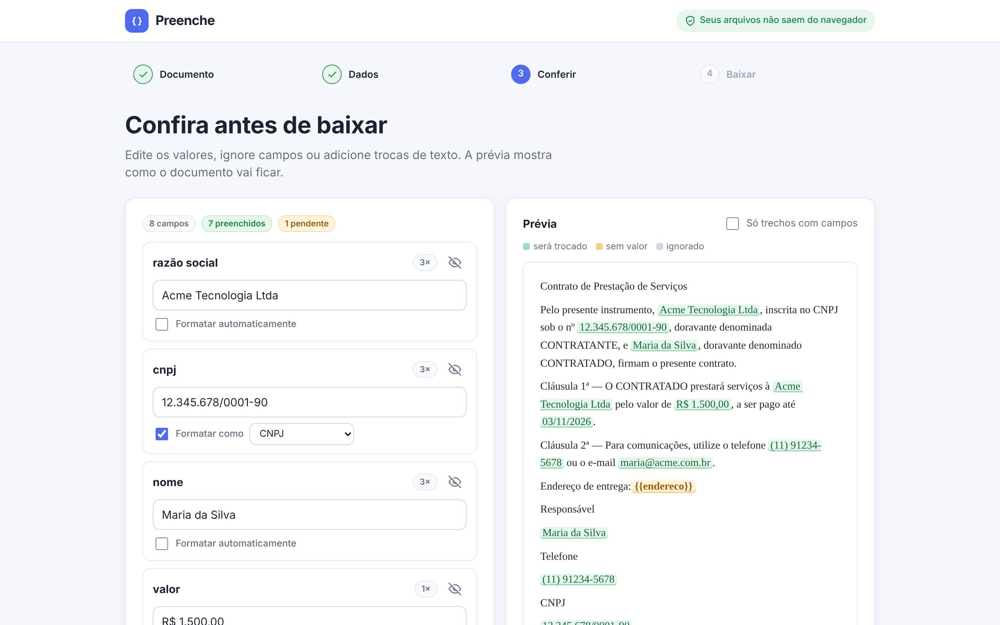
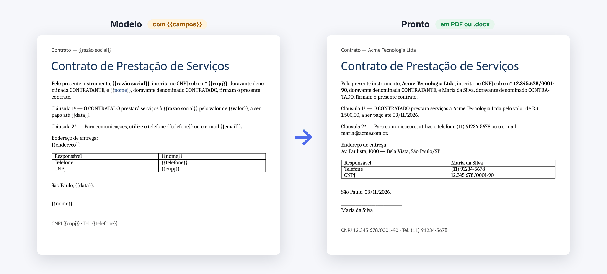
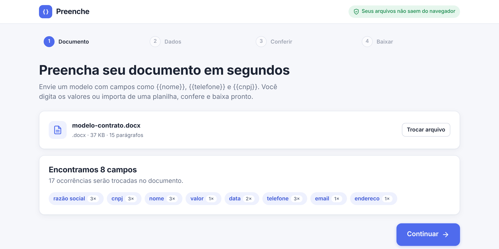
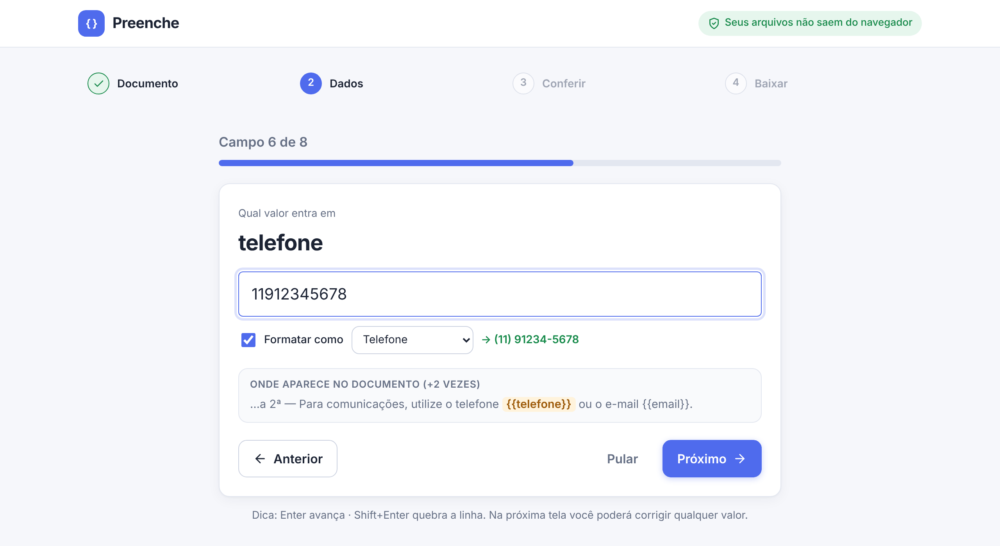
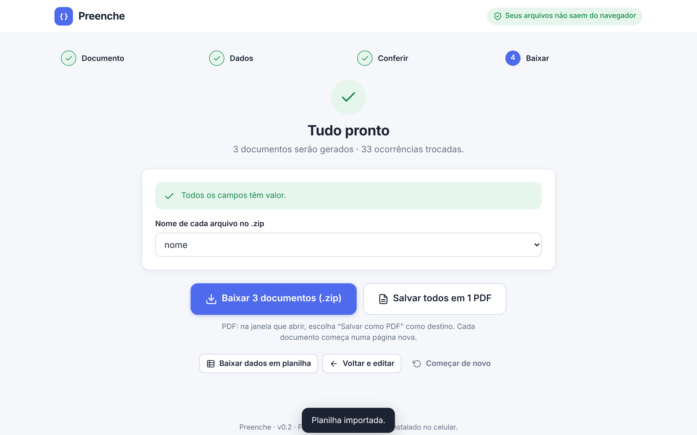
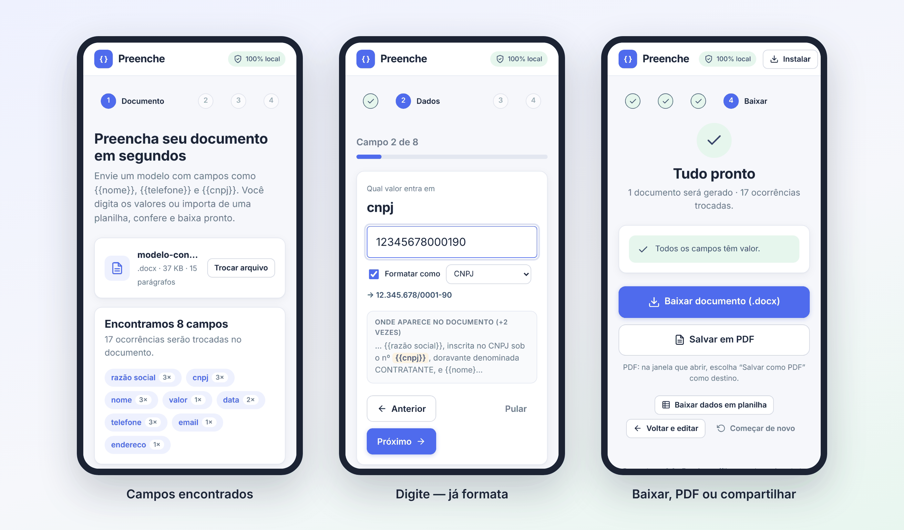

# Preenche

[](https://github.com/victortlacerda/preenche/actions/workflows/testes.yml)

**Preencha contratos, propostas e cartas em segundos.** Envie um documento com campos como `{{nome}}`, `{{telefone}}` e `{{cnpj}}`, informe os valores digitando ou por planilha, confira numa prévia e baixe pronto em **.docx, PDF, .txt ou .md**, um documento ou centenas de uma vez.

Tudo acontece no seu navegador: **nenhum arquivo é enviado para a internet**. Funciona offline e pode ser instalado no celular.

### 👉 [Abrir o app](https://victortlacerda.github.io/preenche/)



---

## Do modelo ao documento pronto



A formatação do Word é mantida: fontes, negrito, tabelas, cabeçalho e rodapé. Só o texto dos campos muda.

## Destaques

- **Reconhece os campos sozinho.** Basta escrever `{{nome do campo}}` no documento. Funciona mesmo quando o Word divide o campo em pedaços, e também em tabelas, cabeçalho, rodapé e caixas de texto.
- **Pergunta campo por campo.** Mostra o trecho do documento onde cada campo aparece. Enter avança.
- **Formata enquanto você digita.** `11912345678` vira `(11) 91234-5678` e `12345678000190` vira `12.345.678/0001-90`.
- **Planilha para vários documentos.** O app gera a planilha-modelo com os campos do seu documento; cada linha vira um documento, entregue num `.zip` ou num PDF só.
- **Confere antes de baixar.** Prévia com o que será trocado (verde) e o que ficou sem valor (âmbar). Dá para ignorar campos ou trocar textos que não têm marcador.
- **PDF com texto de verdade.** Selecionável e nítido, com o tamanho de papel e as margens do documento original.
- **Feito para o celular.** Instale como app, use sem internet e compartilhe o resultado direto por WhatsApp ou e-mail.
- **Privado.** Não tem servidor, cadastro nem envio de dados.

## Como funciona

| 1. Envie o documento | 2. Informe os valores |
|---|---|
|  |  |
| O app lista os campos encontrados e quantas vezes aparecem. | Digite campo a campo (com formatação automática) ou use uma planilha. |

| 3. Confira | 4. Baixe |
|---|---|
|  |  |
| Edite qualquer valor e veja a prévia na hora. | .docx/.txt/.md, PDF, `.zip` com todos ou compartilhar. |

## Vários documentos de uma vez


Baixe a planilha-modelo (já com uma coluna para cada campo), preencha no Excel ou no Google Planilhas e envie de volta. **Cada linha vira um documento.** Os arquivos podem ser nomeados pelo valor de um campo, como `contrato_Ana Souza.docx`.

## No celular



- **Android (Chrome):** toque em **Instalar**, no topo da página.
- **iPhone (Safari):** toque em **Instalar** para ver o passo a passo (*Compartilhar → Adicionar à Tela de Início*).

Depois da primeira visita, o app funciona **sem internet**.

---

## Como marcar os campos

Escreva o nome do campo entre chaves duplas, no lugar onde o valor deve entrar:

```
Contrato firmado com {{razão social}}, CNPJ {{cnpj}}, telefone {{telefone}}.
```

- O mesmo campo pode se repetir quantas vezes quiser.
- Maiúsculas e acentos não fazem diferença: `{{Nome}}` e `{{nome}}` são o mesmo campo.
- Documento antigo, sem marcações? Na conferência, use **Adicionar troca de texto** (por exemplo, trocar "Empresa XYZ" por outro nome).
- Documentos de exemplo para testar: [`exemplos/`](exemplos/).

### Formatação automática

O tipo é sugerido pelo nome do campo e pode ser trocado ou desligado em cada campo.

| Campo com o nome… | Você digita | Sai no documento |
|---|---|---|
| `telefone`, `celular`, `whatsapp` | `11912345678` | (11) 91234-5678 |
| `cnpj` | `12345678000190` | 12.345.678/0001-90 |
| `cpf` | `12345678909` | 123.456.789-09 |
| `cep` | `01310100` | 01310-100 |
| `data`, `vencimento` | `3/11/26` | 03/11/2026 |
| `data por extenso` | `03/11/2026` | 3 de novembro de 2026 |
| `valor`, `preço`, `total` | `1500` | R$ 1.500,00 |

Zeros à esquerda que o Excel costuma apagar (CNPJ, CPF, CEP) são recuperados.

---

## Para quem desenvolve

**Rodar localmente:** dê duplo clique em `index.html`. Não precisa instalar nada; as bibliotecas estão em `vendor/`. Aberto como arquivo local, só o "Instalar como app" não funciona, porque exige `https://`.

**Publicar no GitHub Pages:** *Settings → Pages → Deploy from a branch → `main` / `(root)`*. Para atualizar, basta enviar os arquivos novos; quem instalou recebe a versão nova ao abrir o app com internet.

**Testes:** rodam automaticamente a cada envio (aba **Actions**). No computador:

```
pip install playwright python-docx openpyxl pypdf lxml && playwright install chromium
python3 tests/e2e.py              # testes ponta a ponta
python3 tests/gerar_exemplos.py   # recria os documentos de exemplo
python3 docs/gerar_prints.py      # recria os prints deste README
```

**Estrutura:** HTML, CSS e JavaScript puros, sem build. `js/core.js` (campos e substituição), `js/format.js` (formatação), `js/sheet.js` (planilhas), `js/pdf.js` (PDF), `js/app.js` (telas), `sw.js` + `manifest.webmanifest` (app instalável e offline).

**Bibliotecas incluídas** (`vendor/`):
- [JSZip](https://stuk.github.io/jszip/) 3.10.1 (MIT)
- [SheetJS CE](https://sheetjs.com/) 0.18.5 (Apache-2.0)
- [docx-preview](https://github.com/VolodymyrBaydalka/docxjs) 0.4.1 (Apache-2.0)
- [marked](https://marked.js.org/) 12.0.2 (MIT)

Decisões, próximos passos e histórico: [ROADMAP.md](ROADMAP.md).
